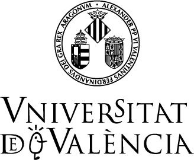
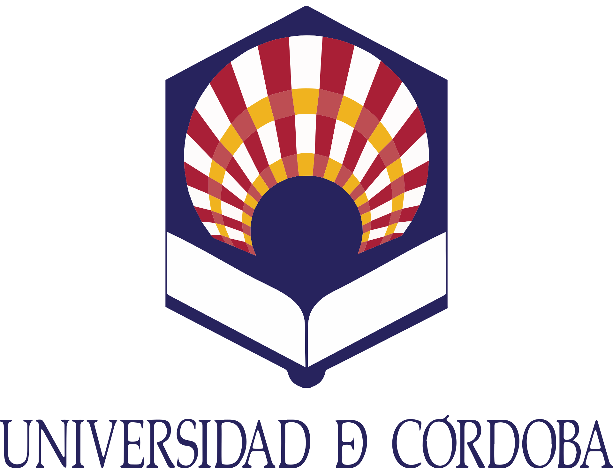

<!--
HOW TO ADD A DEGREE
Copy one 
 ... 
 block and paste it in date order (newest first).
Use class="timeline-item current" for degrees in progress.
Logo files are in images/logos/ (keep the same file names or change the src path).
-->

2025 – present

MSc in Biostatistics

University of Valencia · Valencia, Spain

2019 – present

BSc in Mathematics

National University of Distance Education (UNED) · Málaga, Spain

2015

PhD in Biosciences and Agrifood Sciences

University of Córdoba · Córdoba, Spain

<strong>Thesis:</strong> <em>Detection of Verticillium wilt in olive using high-resolution hyperspectral and thermal remote sensing imagery</em> 
<strong>Supervisors:</strong> Dr. Pablo J. Zarco-Tejada and Dr. Juan A. Navas-Cortés 
<strong>Grade:</strong> Summa cum laude

<a class="pub-btn" href="https://helvia.uco.es/xmlui/handle/10396/12883"><i class="bi bi-file-earmark-text"></i> Read the thesis</a>

2010

MSc in Projects and Management of Agrifood Industries

University of Córdoba · Córdoba, Spain

<strong>Master's thesis:</strong> <em>Three-dimensional LiDAR models to support the remote sensing discrimination of cotton for the control of agricultural subsidies</em> 
<strong>Supervisors:</strong> Dr. José Emilio Meroño de Larriva and Dr. Isabel L. Castillejo-González 
<strong>Grade:</strong> Outstanding

2010

BE in Civil Engineering

University of Córdoba · Bélmez, Córdoba, Spain

2009

BE in Agricultural Engineering

University of Córdoba · Córdoba, Spain

