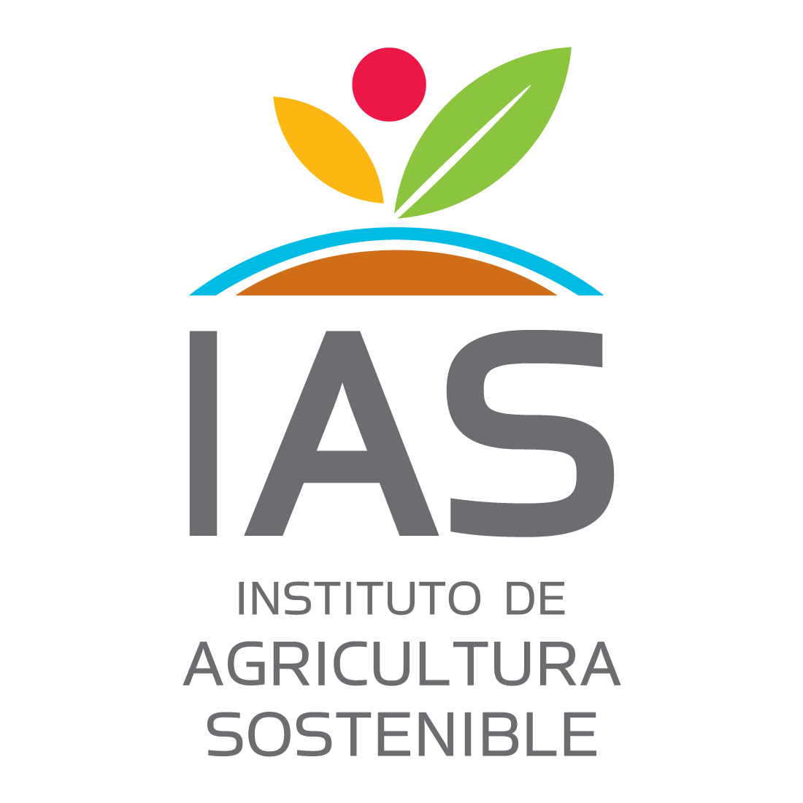
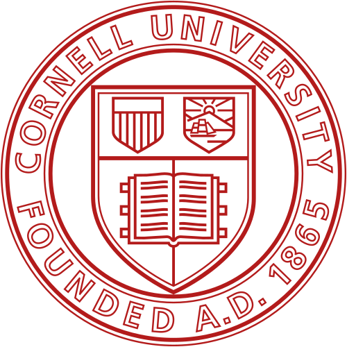
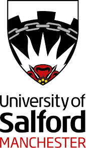
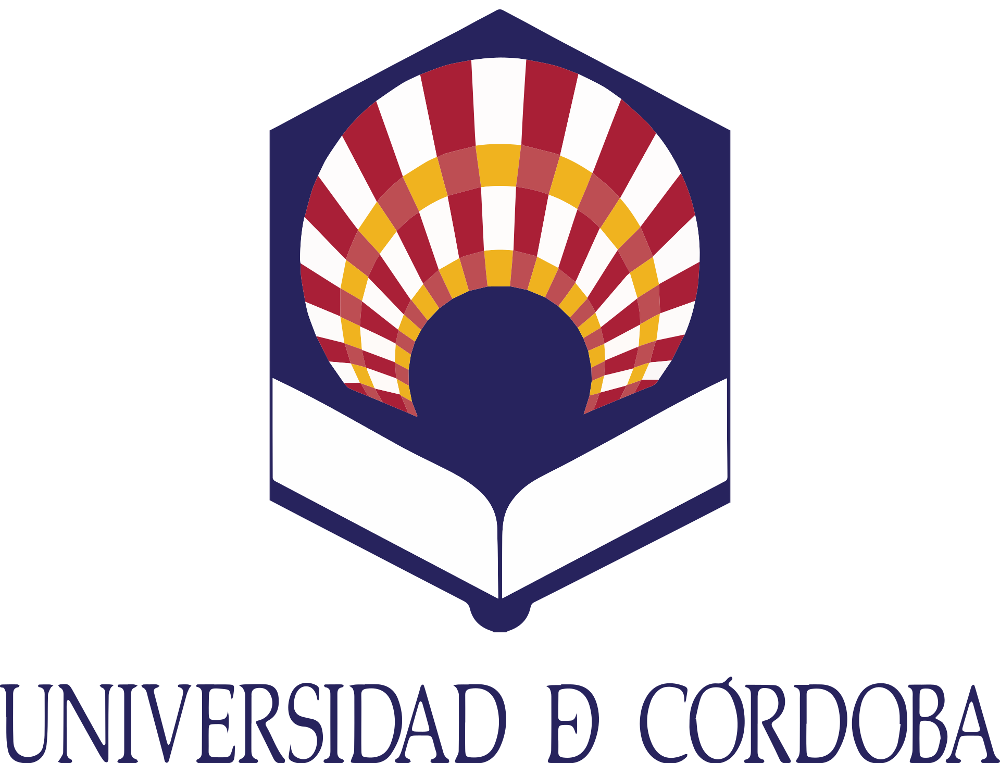

<!--
HOW TO ADD A NEW POSITION
Copy one of the 
 ... 
 blocks below and paste it at the top.
Add the word "current" to the class of your current position: class="timeline-item current"
LOGO (optional), first line inside the block (logo files are in images/logos/):

FUNDING line (optional), put it right after the "where" line:

<i class="bi bi-cash-coin"></i> Funding: <a href="https://...">Programme name</a>

-->

2024 – present
 <!-- TODO: check start year -->

Postdoctoral Associate Researcher

Institute for Sustainable Agriculture (IAS-CSIC) · Córdoba, Spain

<i class="bi bi-cash-coin"></i> Funding: <a href="https://momentum.csic.es">CSIC MOMENTUM Program</a> - MMT24-PTI-SOLXYL-01

Integration of satellite and high-resolution airborne hyperspectral and thermal remote sensing with radiative transfer models, machine learning and epidemiological modelling for the operational surveillance and risk assessment of emerging plant diseases caused by <em>Xylella fastidiosa</em>. Application of species distribution and advanced statistical models to investigate disease establishment and spread, and assess the impacts of climate change and land-use patterns on disease risk.

2021 – 2024

Postdoctoral Associate Researcher

Cornell University · Geneva, NY, USA

<i class="bi bi-cash-coin"></i> Funding: NASA ROSES – Interdisciplinary Research in Earth Science (IDS) (Grant Agreement No. 80NSSC20K1533)

Lead postdoctoral researcher on a NASA-funded project aimed at developing a global surveillance system for Fusarium wilt by integrating satellite remote sensing, atmospheric transport modelling and comparative genomics.

2018 – 2020

Postdoctoral Research Fellow

University of Salford · Manchester, UK

<i class="bi bi-cash-coin"></i> Funding: <a href="https://fundame.org/becas-de-investigacion/">Alfonso Martín Escudero Foundation – Postdoctoral Fellowship for Research at Foreign Universities and Research Centres</a>

Integration of epidemic spread models and high-resolution remote sensing imagery to improve early disease detection and epidemiological model parameterisation, ultimately optimising surveillance and control strategies for <em>Xylella fastidiosa</em>.

2017

Research Associate

Institute for Sustainable Agriculture (IAS-CSIC) · Córdoba, Spain

<i class="bi bi-cash-coin"></i> Funding: <a href="http://www.sustainfarm.eu/es/">SustainFARM – ERA-NET FACCE SURPLUS</a>, funded under the European Union’s Horizon 2020 Research and Innovation Programme (Grant Agreement No. 652615)

Integration of crop physiology and high-resolution hyperspectral and thermal remote sensing to assess water stress in almond and olive orchards to support sustainable irrigation management.

2014 – 2015

Postgraduate Researcher

Institute for Sustainable Agriculture (IAS-CSIC) · Córdoba, Spain

<i class="bi bi-cash-coin"></i> Funding: Spanish Ministry of Economy and Competitiveness (MINECO) – National R&D Programme, Project AGL2012-40053-C03-01

Development of machine learning algorithms using hyperspectral and thermal data for the early detection of Verticillium wilt in olive trees.

2010 – 2014

PhD Research Fellow

Institute for Sustainable Agriculture (IAS-CSIC) · Córdoba, Spain

<i class="bi bi-cash-coin"></i> Funding: Predoctoral Research Fellowship (FPI 2010), associated with research project AGL2009-13105-C03-01 – Spanish Ministry of Science and Innovation (MICINN)

PhD research focused on developing quantitative remote sensing methods for the early detection of Verticillium wilt in olive and downy mildew in opium poppy, using high-resolution airborne hyperspectral, multispectral and thermal imagery.

2008 – 2009

Undergraduate Research Fellow

University of Córdoba · Córdoba, Spain

<i class="bi bi-cash-coin"></i> Funding: Research Fellowship funded under the agreement between the Regional Ministry of Agriculture and Fisheries of Andalusia and the University of Córdoba, within the project “Design of Instruments and Protocols for the Incorporation of New Technologies for the Monitoring and Control of Agricultural Subsidies”

Development of 3D models from airborne LiDAR data to discriminate herbaceous crops for the monitoring and control of EU agricultural subsidies.

## Awards and recognitions

- **2018** · Postdoctoral Fellowship from the Alfonso Martín Escudero Foundation
- **2016** · XVI Award for Best Doctoral Thesis from the Andalusian Association of Agricultural Engineers
- **2010** · Predoctoral Research Fellowship (FPI 2010)
- **2008** · Undergraduate Research Fellowship funded by the Regional Ministry of Agriculture and Fisheries of the Andalusian Government, in collaboration with the University of Córdoba

