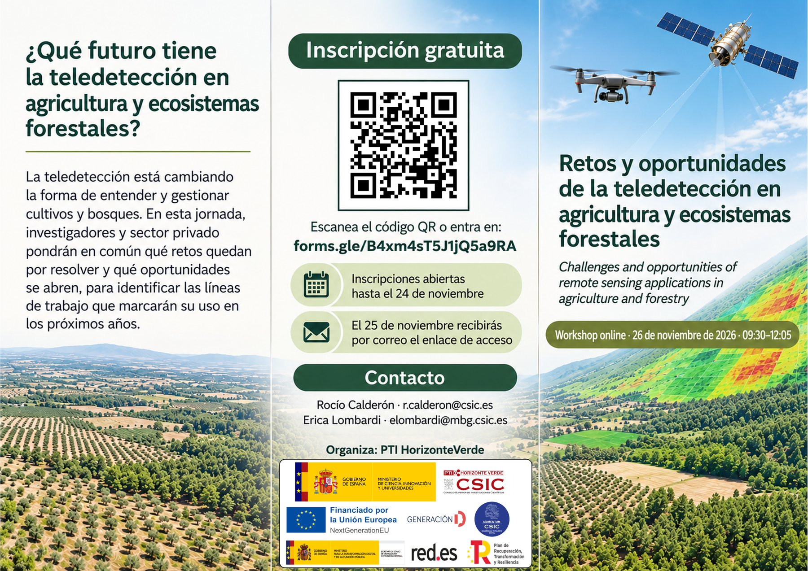
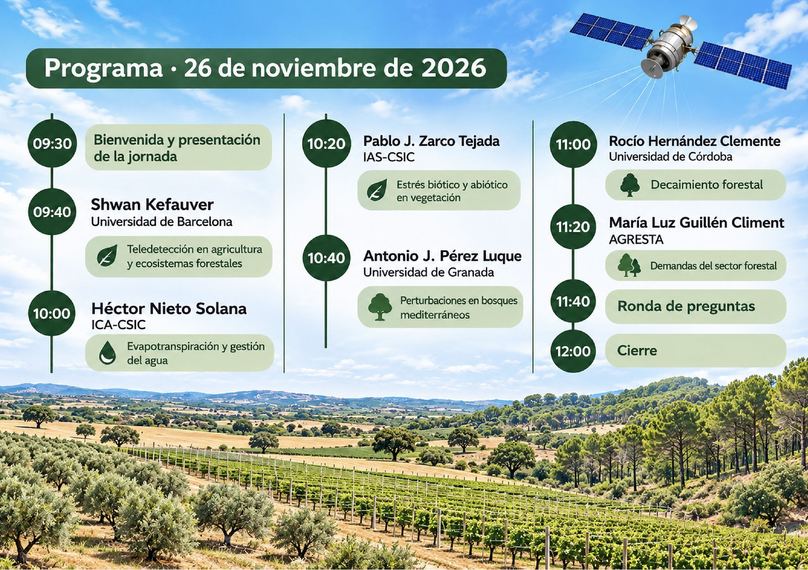

Together with **Erica Lombardi** (MBG-CSIC), I am coordinating the online workshop ***"Retos y oportunidades de la teledetección en agricultura y ecosistemas forestales"*** (Challenges and opportunities of remote sensing in agriculture and forest ecosystems), organised by the CSIC Interdisciplinary Thematic Platform **PTI Horizonte Verde**.

The workshop brings together researchers and the private sector to discuss the open challenges and new opportunities of remote sensing for crops and forests.

::: {.project-facts}
**Date:** Thursday, 26 November 2026 · 09:30–12:05 (CET)  
**Format:** Online · Free  
**Organised by:** CSIC PTI Horizonte Verde (coordinator: Dr. Helena Gómez Macpherson, IAS-CSIC)  
**Coordinators:** Erica Lombardi (MBG-CSIC) and Rocío Calderón (IAS-CSIC), MOMENTUM researchers  
**Registration:** open until 24 November · the access link will be sent by email on 25 November
:::

<a class="pub-btn" href="https://forms.gle/B4xm4sT5J1jQ5a9RA" target="_blank"><i class="bi bi-pencil-square"></i> Register (free)</a>
<a class="pub-btn" href="https://www.ias.csic.es/retos-y-oportunidades-de-la-teledeteccion-en-agricultura-y-ecosistemas-forestales/" target="_blank"><i class="bi bi-calendar-event"></i> Full programme</a>
<a class="pub-btn" href="https://www.csic.es/es/agenda-del-csic/retos-y-oportunidades-de-la-teledeteccion-en-agricultura-y-ecosistemas-forestales" target="_blank"><i class="bi bi-info-circle"></i> CSIC agenda</a>

## Programme

| Time | Speaker | Talk |
|---|---|---|
| 09:30 | | Welcome and introduction |
| 09:40 | **Shwan Kefauver** · University of Barcelona | Remote sensing in agriculture and forest ecosystems |
| 10:00 | **Héctor Nieto Solana** · ICA-CSIC | Evapotranspiration and water management |
| 10:20 | **Pablo J. Zarco-Tejada** · IAS-CSIC | Biotic and abiotic stress in vegetation |
| 10:40 | **Antonio J. Pérez Luque** · University of Granada | Disturbances in Mediterranean forests |
| 11:00 | **Rocío Hernández Clemente** · University of Córdoba | Forest decline |
| 11:20 | **María Luz Guillén Climent** · AGRESTA | Demands of the forestry sector |
| 11:40 | | Questions and discussion |
| 12:00 | | Closing |

## Leaflet and programme

Click on the images to enlarge them.

::: {layout-ncol=2}
{group="workshop"}

{group="workshop"}
:::

