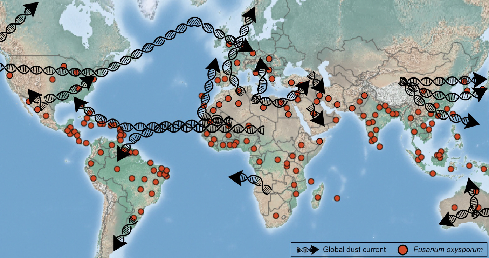

{fig-alt="Fusarium wilt project"}

::: {.project-facts}
**Project:** Soilborne plant pathogen dispersal and assessment: Building a remote sensing-based global surveillance system for plant disease  
**Funding:** NASA ROSES-2019 – Interdisciplinary Research in Earth Science (IDS) · Grant No. 80NSSC20K1533  
**Role:** Lead Postdoctoral Associate Researcher  
**Institution:** Cornell University (Cornell AgriTech) · Geneva, NY, USA  
**Principal investigator:** Dr. Kaitlin M. Gold (Cornell University)  
**Co-investigators:** Dr. Natalie M. Mahowald (Cornell University), Dr. Sharifa G. Crandall (Pennsylvania State University) and Dr. Ryan Pavlick (NASA Jet Propulsion Laboratory, California Institute of Technology)  
**Period:** 2021 – 2024
:::

## Overview

### Background

Plant diseases destroy around **15% of the food grown worldwide**, with annual losses of roughly US$220 billion, and fungi cause about 80% of them, many of the most aggressive being soilborne. ***Fusarium oxysporum***, the causal agent of **Fusarium wilt**, ranks among the ten most damaging fungal plant pathogens: it is present on all six crop-producing continents, infects more than 100 host species, causes yield losses of 10–60% and produces resistant spores that can survive in the soil for decades. New virulent strains able to overcome host resistance, such as Tropical Race 4 in banana, and a warmer climate that expands its suitable range make it a growing threat to food security.

At the same time, wind erosion of dry agricultural land is an important source of atmospheric dust, and soil microbes travel attached to dust particles. Spores and DNA of *F. oxysporum* have been found in North African and Asian dust samples, raising the possibility that soilborne pathogens can spread across continents through the atmosphere.

### Knowledge gaps

- **No global surveillance system for crop diseases.** International efforts to monitor plant disease outbreaks are limited by scarce resources and poor information exchange, and remote sensing has rarely been considered as part of the solution: the disciplines of plant pathology and Earth observation remain largely disconnected.
- **Coarse and incomplete risk assessments.** Global assessments of Fusarium wilt risk rely on sparse surveillance records and coarse climate data, and ignore the distribution and activity of susceptible crops and other environmental drivers that satellites can now measure.
- **Unknown role of airborne dispersal.** Long-distance dispersal of foliar pathogens is well studied, but whether soilborne pathogens travel with global dust currents has never been demonstrated, and management recommendations for soilborne diseases do not consider airborne spread at any scale.
- **Unknown genetic basis of dispersal.** Little is known about which plant pathogens actually travel with dust, or about the spore traits that allow them to survive atmospheric transport.

::: {.project-aim}
**Project aim:** to bridge plant pathology and Earth observation by combining **satellite remote sensing**, **aerosol transport modelling** and **comparative genomics**, and to lay the foundations of a **remote sensing-based global surveillance system** that maps the risk of Fusarium wilt and the atmospheric dispersal of *F. oxysporum* under current and future climate.
:::

## Objectives

1. **Susceptibility assessment:** identify agricultural regions that are both suitable for Fusarium wilt and arid enough to act as dust sources, using satellite-derived environmental, vegetation and cropland data.
2. **Atmospheric transport modelling:** evaluate the risk of global pathogen movement by simulating the entrainment, transport and deposition of spores carried by aerosolised agricultural soil.
3. **Comparative genomics:** compare *F. oxysporum* genomes from isolates spanning many host species to identify genetic traits that influence spore dispersal, atmospheric survival and pathogenicity.
4. **Integration and prediction:** combine these components into a remote sensing-based risk assessment of the global incidence of *F. oxysporum* under different climate change scenarios.


## Approach: three research pillars

The project combined three disciplines that rarely work together, each answering a different part of the question.

::: {.card-grid .three-cols}

::: {.skill-card}
### <i class="bi bi-globe-americas"></i> 1 · Remote sensing risk assessment
Fusarium wilt risk was mapped within the **plant disease triangle** framework, where disease results from a virulent pathogen infecting a susceptible host in a conducive environment:

- **Pathogen:** a public global web map with more than 4,500 *F. oxysporum* records from the peer-reviewed literature.
- **Host:** Landsat cropland fraction, MODIS land cover dynamics and solar-induced chlorophyll fluorescence (SIF) as a proxy for crop activity.
- **Environment:** long-term satellite products of land surface and air temperature, precipitation, soil moisture and evapotranspiration.

These layers fed an **ensemble of species distribution algorithms** at 1 km resolution, projected to 2100 under three CMIP6 climate scenarios.
:::

::: {.skill-card}
### <i class="bi bi-wind"></i> 2 · Aerosol transport modelling
The Earth system model **CESM2-CAM6** was adapted, through the MIMI dust framework, to include **agricultural dust emissions** and the concentration of *F. oxysporum* spores in soil estimated from the web map.

Spore viability during transport was simulated with an exponential decay function driven by **UV exposure**. The model was tested with the **"Godzilla" dust storm** of June 2020, which carried Saharan dust to the south-eastern United States.
:::

::: {.skill-card}
### <i class="bi bi-diagram-3"></i> 3 · Comparative genomics
Dust samples were collected from air filters **before, during and after a major dust event** at two deposition sites, **Cayenne (French Guiana) and Barbados**, and cultured to identify the fungi travelling with dust.

Genomic analyses were used to identify plant pathogens in the dust and the spore traits that may affect dispersal and atmospheric survival, combined with HYSPLIT back-trajectories of the air masses.

:::

:::

## Main findings

::: {.card-grid .three-cols}

::: {.skill-card}
### <i class="bi bi-map"></i> Fusarium wilt risk
- About **20.7% of global land and 70.8% of cropland** are currently suitable for Fusarium wilt.
- Suitability is driven by **temperature and soil moisture**, and shaped by **cropland extent and host activity (SIF)**.
- Risk **expands by 2100 in all climate scenarios**, mainly through warming at mid- to high northern latitudes and cropland expansion and hydrological change in northern Sub-Saharan Africa, while several Southern Hemisphere regions show net losses.
:::

::: {.skill-card}
### <i class="bi bi-cloud-haze2"></i> Long-distance spore transport
- During the Godzilla storm, **about 13,000 of 4 trillion spores** from North Africa reached the Americas **still viable**, with Mexico and the Caribbean as the areas at highest risk of deposition on cropland.
- Globally, transport is dominated by **Eurasia–Africa interactions**, and **Sub-Saharan Africa is the main hub**, the source of 53% of all viable spore deposition.
:::

::: {.skill-card}
### <i class="bi bi-bug"></i> Pathogens in dust
- Dust carried diverse fungal communities with potential plant and human pathogens, such as ***Colletotrichum*** and ***Cladosporium***, plus many rare taxa.
- ***F. oxysporum* spores were abundant in Cayenne after the dust storm**, supporting the modelling evidence of long-distance transport.
:::

:::

## Take-home message

Pathosystem distribution modelling turns remote sensing data streams into **actionable risk assessments**. Fusarium wilt risk will **expand regardless of the climate change scenario**, and both models and genomic data show that **soilborne pathogens can travel long distances with dust**. The project lays the foundation for using the new generation of **hyperspectral satellites**, together with other remote sensing tools, in a **global surveillance system for crop diseases**, a line of work I continue in the [MOMENTUM project](momentum.qmd).

## Outputs

::: {.card-grid .two-cols}

::: {.skill-card}
### <i class="bi bi-journal-text"></i> Publications
- **Web map of *F. oxysporum*** · *Plant Disease* (2023) · [DOI](https://doi.org/10.1094/PDIS-04-22-0789-A)
- **Atmospheric transport of soilborne pathogens** · *Environmental Research Letters* (2023) · [DOI](https://doi.org/10.1088/1748-9326/acf50c)
- **Global Fusarium wilt risk under climate change** · preprint at *agriRxiv* (2026) · [DOI](https://doi.org/10.31220/agriRxiv.2026.00390)
- **Fungal pathogens transported in dust (comparative genomics)** · *in preparation*
:::

::: {.skill-card}
### <i class="bi bi-box-seam"></i> Open resources and training
- [Interactive web map](https://experience.arcgis.com/experience/1e6014e6634948808a283d0a3b147bfe) of *F. oxysporum* diversity and distribution
- [Code on GitHub](https://github.com/rcalderonmadrid/Ensemble_SDMs_for_Global_Fusarium_Wilt_Risk) and [data on figshare](https://doi.org/10.6084/m9.figshare.30416476) for the global risk models
- More than 10 talks and posters at AGU, NASA, APS, ICPP and the International Epidemiology Workshop ([see all](../publications.qmd#pub-conferences))
- Co-supervision of an undergraduate honors thesis at Cornell University (2022) ([see Mentoring](../mentoring.qmd))
:::

:::

## Interactive web map {#web-map}

Global diversity and distribution of *Fusarium oxysporum* formae speciales. Zoom in and click on the points to see the details of each record.

```{=html}
<div class="webmap">
  <iframe src="https://experience.arcgis.com/experience/1e6014e6634948808a283d0a3b147bfe" title="Interactive web map of Fusarium oxysporum ff. spp." loading="lazy" allowfullscreen></iframe>
</div>
<p><a class="pub-btn" href="https://experience.arcgis.com/experience/1e6014e6634948808a283d0a3b147bfe" target="_blank"><i class="bi bi-box-arrow-up-right"></i> Open the map in full screen</a></p>
```
