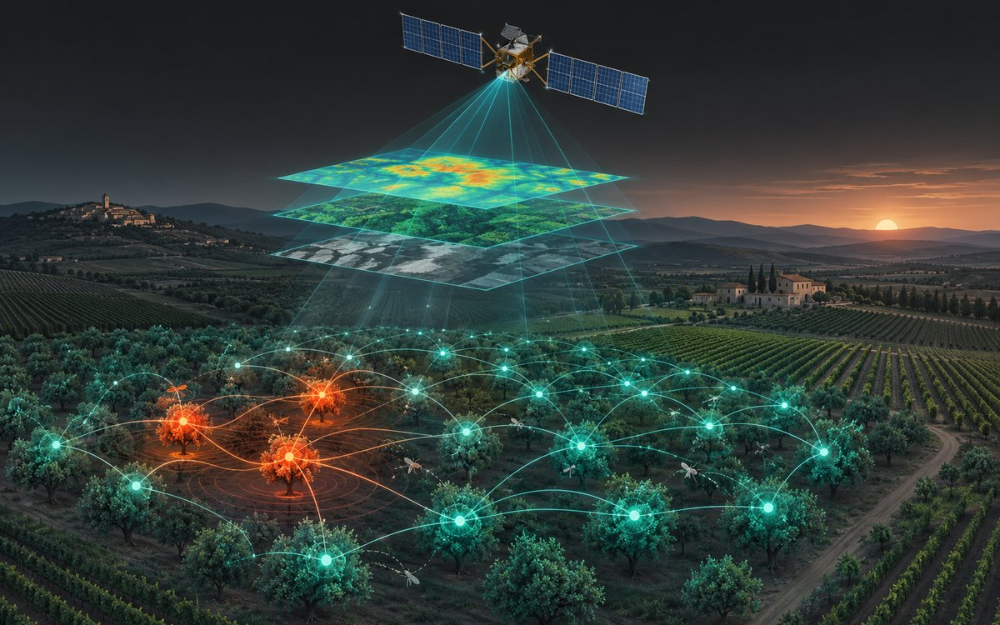

{fig-alt="MOMENTUM project"}

## About MOMENTUM

[MOMENTUM](https://momentum.csic.es) is the CSIC **Programme for Attracting and Retaining Digital Talent**. It offers four-year contracts that combine an R&D project with a **personalised training plan in advanced digital skills**, such as artificial intelligence, data science, Earth observation and computational modelling. The goal is to train researchers who can lead the digital transformation of science in their own field.

::: {.project-facts}
**Project:** Integration of remote sensing and epidemiological models for the operational surveillance and risk assessment of emerging plant diseases in a climate change context  
**Programme:** [CSIC MOMENTUM Programme](https://momentum.csic.es) for attracting and retaining digital talent · Ref. MMT24-PTI-SOLXYL-01  
**Framework:** CSIC Interdisciplinary Thematic Platform [PTI SOL-XYL](https://pti-solxyl.csic.es) – Innovative approaches for research and solutions to diseases caused by *Xylella fastidiosa* in cultivated plants (coordinator: Dr. Blanca B. Landa)  
**Role:** MOMENTUM Postdoctoral Researcher  
**Host institution:** Institute for Sustainable Agriculture (IAS-CSIC), Córdoba, Spain  
**Principal investigators:** Dr. Juan A. Navas-Cortés (IAS-CSIC) and Dr. Antonio Vicent (IVIA)  
**Period:** 2024 – present
:::

## Overview

The spread of emerging plant diseases, intensified by climate change and globalisation, threatens crop production and food supply chains. This project proposes a **"digital plant pathology"** approach for *Xylella fastidiosa*, ranked as the **top priority plant pest in the European Union**.

The new era of open **hyperspectral satellite data** and **artificial intelligence** is transforming plant epidemiology. Hyperspectral satellites combine the operational coverage that airborne sensors lack with a continuous spectrum that multispectral satellites cannot provide, allowing a more accurate quantification of the physiological and biochemical traits of plants and of their response to pathogens. By feeding these observations into **epidemiological and species distribution models**, the project overcomes the lack of data that limits current predictions, and turns them into risk assessments that are useful for agricultural and governmental decision-makers.

The work focuses on crops affected by *X. fastidiosa* in Spain, mainly **almond and grapevine**.

## Objectives

1. **Evaluate the use of hyperspectral and multispectral satellite imagery for the detection and monitoring of diseases caused by *X. fastidiosa* in cultivated plants at regional scale.**
    - **1.1.** Analyse the accuracy and contribution of spectral traits of cultivated plants and surrounding wild vegetation retrieved through Radiative Transfer Models (RTMs), using high-spatial-resolution (<1 m) hyperspectral and thermal data and field data as reference, to detect early, intermediate and severe levels of symptom severity.
    - **1.2.** Develop generalisable machine learning (ML) algorithms based on satellite imagery for the operational monitoring of diseases caused by *X. fastidiosa*.

2. **Integrate hyperspectral and multispectral satellite imagery into epidemiological models to improve their parameterisation and optimise the surveillance and control of diseases caused by *X. fastidiosa*.**
    - **2.1.** Quantitatively assess epidemiological parameters essential for risk assessment.
    - **2.2.** Develop optimised statistical strategies to inform surveillance and control programmes for diseases caused by *X. fastidiosa*.

3. **Improve the risk assessment of emerging diseases in the context of climate change by integrating satellite data, species distribution models and epidemiological disease spread models.**
    - **3.1.** Identify the underlying biotic and abiotic factors that promote the establishment and spread of diseases caused by *X. fastidiosa* in agricultural ecosystems.
    - **3.2.** Investigate the implications of climate change and land use for the risk of establishment and spread of diseases caused by *X. fastidiosa*.

## Approach

We propose a synergistic approach that combines the strengths of hyperspectral and multispectral satellite remote sensing for the detection and monitoring of emerging plant diseases. The high spectral resolution of hyperspectral satellite data will enable the accurate quantification of plant functional traits that are sensitive to the progression of biotic stress, including chlorophyll fluorescence, while the high spatial resolution of multispectral satellite data will allow the identification of the components of the scene, facilitating the parameterisation of radiative transfer models. These functional traits, together with spectral vegetation indices, will be estimated with radiative transfer models and integrated into supervised machine learning classification models, using disease incidence and symptom severity data collected in field campaigns, as well as high-spatial-resolution hyperspectral and thermal imagery, as benchmark.

The high temporal coverage of hyperspectral and multispectral satellite data will improve the assessment of the spatio-temporal dynamics of pathogen infections, capturing the seasonal transmission by insect vectors. By integrating these data into epidemiological models, more accurate models can be built to predict the spread of insect-transmitted diseases such as *X. fastidiosa*. We will design a stochastic, spatially explicit compartmental model that incorporates the seasonal movements of the vectors and the different epidemiological states of the plants over time, using time series of disease indicators derived from hyperspectral and multispectral satellite data. We will apply Bayesian inference to fit the model parameters using both visual field inspection data and satellite data, in order to compare both estimates. This parameterised model will include simulation modules to evaluate the effectiveness of different surveillance and control strategies.

To improve the risk assessment of emerging diseases, species distribution models will be adapted to incorporate pathogen dispersal through the previously parameterised epidemiological model, thus capturing the dynamic interaction between vector, host, pathogen and environment. Publicly available occurrence data of the pathogen and its vectors will be used, and hyperspectral and multispectral satellite data will be employed to map susceptible hosts and the environmental factors that favour disease development. We will integrate these data into species distribution models to generate current disease risk maps and to identify the most relevant abiotic and biotic factors for disease establishment. These factors will then be obtained from climate simulations of the Coupled Model Intercomparison Project Phase 6 (CMIP6), or its updates, to explore the implications of future climate change and land use. By incorporating pathogen dispersal, we will estimate the risk of persistence and subsequent epidemic development when the pathogen is randomly introduced into pathogen-free areas, enabling the design of proactive surveillance protocols.

## Training plan

As part of the MOMENTUM contract, I follow a four-year training plan of **266 ECTS** in advanced digital skills, designed together with my supervisors, Dr. Juan A. Navas-Cortés and Dr. Antonio Vicent.

::: {.card-grid .two-cols}

::: {.skill-card}
### <i class="bi bi-laptop"></i> Digital skills · 100 ECTS
- **MSc in Biostatistics**, University of Valencia (90 ECTS), with a specialisation in epidemiology, environment and natural systems
- Specialised courses: Python and R programming, spatial and spatio-temporal statistics, GIS, deep learning for geosciences, satellite image processing with Google Earth Engine and species distribution models
- Workshops on CSIC high-performance computing (HPC) resources
:::

::: {.skill-card}
### <i class="bi bi-airplane"></i> Research stays · 60 ECTS
- **National stay at the Valencian Institute for Agricultural Research (IVIA)**, about 15 months, with Dr. Antonio Vicent: epidemiological modelling and decision-support systems for plant disease management
- **International stay of about 3 months** (destination to be confirmed): radiative transfer models and hyperspectral satellite data to quantify plant physiological and biochemical traits
:::

::: {.skill-card}
### <i class="bi bi-cpu"></i> Research activities · 90 ECTS
- Supervised research: regular tutoring, group seminars, and field and laboratory work
- Independent research: design and validation of epidemiological models, machine learning algorithms and digital tools for data analysis
:::

::: {.skill-card}
### <i class="bi bi-people"></i> Complementary training · 16 ECTS
- Presentations at national and international conferences and workshops
- Outreach events, such as the European Researchers' Night
- Supervision of students (PhD students, JAE-Intro fellows, Bachelor's and Master's theses)
:::

:::

## Expected impact

The new era of open satellite data, artificial intelligence and computational biology is revolutionising plant epidemiology, driving a new paradigm in the understanding, surveillance and control of emerging plant diseases. This project stands at the forefront of this change, aiming to achieve accurate detection, real-time monitoring and robust assessment of the risk of disease establishment and spread in a context of climate change. This synergy will make it possible to design more precise and efficient surveillance and control strategies, preventing and mitigating the adverse impacts of emerging diseases such as *X. fastidiosa* on crops.

In addition, this research will advance the field of Earth observation by aligning with the objectives of the European Space Agency (ESA) to improve operational applications related to food security and sustainable agriculture, and to support data-driven plant health policy-making. The project also fits within the Horizon Europe 2021–2024 strategic plan. By taking advantage of advances in digital and data technologies, together with Earth observation applications for monitoring, modelling and forecasting, it will help to increase the resilience and sustainability of agricultural systems and improve their capacity to respond to plant pathogens, especially in the context of the potential aggravating effects of climate.

## Open science

Results will be published in open access, and the modelling code (R and Python), data and maps will be shared in open repositories such as [Digital.CSIC](https://digital.csic.es), [Zenodo](https://zenodo.org) and [GitHub](https://github.com/rcalderonmadrid).

<!-- TODO: add study areas, figures, publications and news as the project progresses -->
