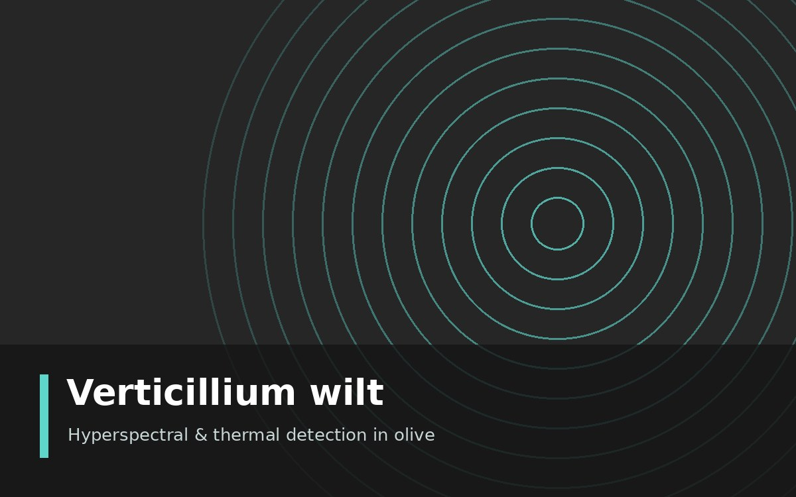

{fig-alt="Verticillium wilt project"}

::: {.project-facts}
**Institution:** Institute for Sustainable Agriculture (IAS-CSIC), Córdoba, Spain  
**Period:** 2010 – 2015 (PhD research)  
**Collaborators:** J. A. Navas-Cortés, P. J. Zarco-Tejada
:::

## Overview

Verticillium wilt, caused by the soilborne fungus *Verticillium dahliae*, is one of the most damaging diseases of olive. My PhD research demonstrated that **fluorescence, canopy temperature and narrow-band spectral indices** derived from high-resolution hyperspectral and thermal imagery can detect the disease at **early stages**, first with unmanned aerial vehicles at orchard scale and then with manned aircraft over large areas. The same approach was applied to other crop diseases such as downy mildew of opium poppy and red leaf blotch of almond.

## Key publications

- Calderón, R., Zarco-Tejada, P. J., Lucena, C. & Navas-Cortés, J. A. (2013). High-resolution airborne hyperspectral and thermal imagery for pre-visual detection of Verticillium wilt using fluorescence, temperature and narrow-band indices. *Remote Sensing of Environment*, 139, 231–245. [Link](https://www.sciencedirect.com/science/article/abs/pii/S0034425713002435)
- Calderón, R., Navas-Cortés, J. A. & Zarco-Tejada, P. J. (2015). Early detection and quantification of Verticillium wilt in olive using hyperspectral and thermal imagery over large areas. *Remote Sensing*, 7, 5584–5610. [Link](https://www.mdpi.com/2072-4292/7/5/5584)
- Calderón, R. et al. (2014). Soil temperature determines the reaction of olive cultivars to *Verticillium dahliae* pathotypes. *PLOS ONE*, 9(10), e110664. [DOI](https://doi.org/10.1371/journal.pone.0110664)
