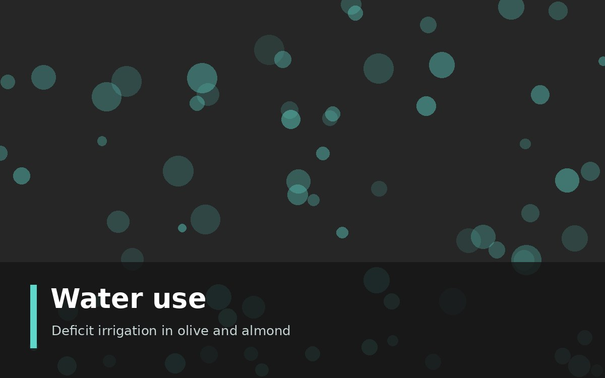

{fig-alt="Water use project"}

::: {.project-facts}
**Institution:** University of Córdoba / IAS-CSIC <!-- TODO: check -->  
**Period:** YEAR – YEAR <!-- TODO -->
:::

## Overview

Research on **deficit irrigation strategies in olive and almond**, monitoring plant water status with the pressure chamber (stem water potential) and physiological measurements such as **chlorophyll fluorescence** and **gas exchange**.

<!-- TODO: describe the project, your role and any related publications -->
